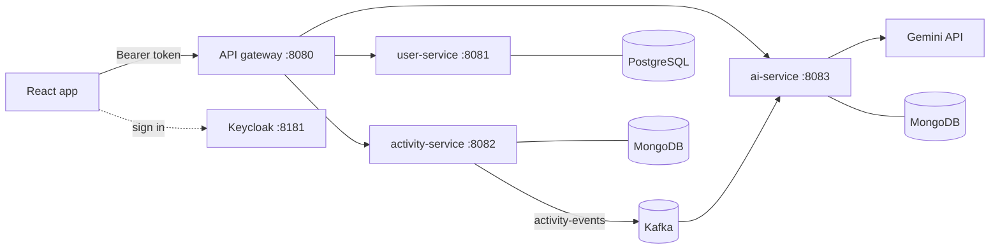

# Pulse

A workout log with an AI coach attached. You record a session, say a 40-minute run with distance and heart rate, and a few seconds later Gemini has written up what went well, what to work on and what to do next.

I built it to learn Spring microservices properly, so the backend is split into real services (gateway, discovery, config server, one service per domain, Kafka in between) instead of one app with a lot of packages. The frontend is a React single-page app that signs in through Keycloak.


https://github.com/user-attachments/assets/98c0f3fb-9f7e-4552-b8b9-419271334c38


## What it does

- Sign in with Keycloak using the OAuth 2.0 authorization code flow with PKCE.
- Log activities across ten types. Each type asks for metrics that make sense for it: distance and heart rate for a run, sets and reps for lifting, laps and stroke for swimming.
- Dashboard with totals, a seven-day chart and your current streak, all calculated from what you have logged.
- Activity history, and a detail page for every session.
- AI-written notes per session: analysis, improvements, suggested workouts and safety tips.

## How it fits together



1. The browser gets a token from Keycloak and sends it to the gateway with every request.
2. The gateway validates the JWT, makes sure the user exists in `user-service` (it registers them on first login) and forwards the request with an `X-User-ID` header taken from the token. Services use that header and never an ID supplied by the client.
3. `activity-service` checks the user, stores the activity and publishes it to Kafka.
4. `ai-service` consumes the event, builds a prompt from the activity and its metrics, calls Gemini and stores the result. The frontend polls until the recommendation exists.

Saving an activity never waits on the AI. If Gemini is down or overloaded the activity is still saved, and the recommendation falls back to generic text.

| Module | Port | Role | Storage |
|---|---|---|---|
| `configserver` | 8888 | Serves configuration to every other service | none |
| `eureka` | 8761 | Service discovery | none |
| `gateway` | 8080 | Routing, JWT validation, user sync, CORS | none |
| `userservice` | 8081 | User profiles | PostgreSQL |
| `activityservice` | 8082 | Activities, Kafka producer | MongoDB `aiactivityfitness` |
| `aiservice` | 8083 | Kafka consumer, Gemini integration | MongoDB `aiactivityrecommendation` |
| `fitness-frontend` | 5173 | React app | none |

## Stack

- **Backend:** Java 25, Spring Boot 4.1, Spring Cloud 2025.1 (Gateway, Eureka, Config), Spring Security as an OAuth2 resource server, Spring Data JPA and MongoDB, Spring for Apache Kafka, WebClient
- **Frontend:** React 19, Vite, Material UI 9, Redux Toolkit, React Router 7, react-oauth2-code-pkce
- **Infrastructure:** Keycloak, PostgreSQL, MongoDB, Kafka
- **AI:** Google Gemini through the Interactions API, with a fallback chain across models

## Running it locally

### You need

- JDK 25 and Node 22 or newer (each service ships a Maven wrapper)
- MongoDB on 27017, PostgreSQL on 5432, Kafka on 9092, Keycloak on 8181
- A Gemini API key from Google AI Studio

### One-time setup

**Keycloak.** Create a realm called `fitness-realm` and a public client called `oauth2-pkce-client` with the standard flow enabled and PKCE set to `S256`. Valid redirect URIs: `http://localhost:5173/*`. Web origins: `http://localhost:5173`. Add a user with an email address, first name and last name; the gateway copies these into the user service on first login.

**PostgreSQL.** Create the database. Tables are created automatically on first start.

```sql
CREATE DATABASE "fitness-micro-user";
```

The username and password live in `configserver/src/main/resources/config/user-service.yaml`. Change them to match your machine and do not commit real credentials.

**Gemini.** Set two environment variables for the AI service. It will not start without them.

```powershell
# PowerShell
$env:GEMINI_KEY = "your-api-key"
$env:GEMINI_URL = "https://generativelanguage.googleapis.com"
```

```bash
# bash
export GEMINI_KEY="your-api-key"
export GEMINI_URL="https://generativelanguage.googleapis.com"
```

### Start everything

Order matters. Run each service in its own terminal and wait for it to finish starting before moving on.

```bash
cd configserver     && ./mvnw spring-boot:run   # 1. config, port 8888
cd eureka           && ./mvnw spring-boot:run   # 2. discovery, port 8761
cd userservice      && ./mvnw spring-boot:run   # 3
cd activityservice  && ./mvnw spring-boot:run   # 3
cd aiservice        && ./mvnw spring-boot:run   # 3 (needs the Gemini variables)
cd gateway          && ./mvnw spring-boot:run   # 4. last
cd fitness-frontend && npm install && npm run dev
```

Open <http://localhost:8761> and check that `API-GATEWAY`, `USER-SERVICE`, `ACTIVITY-SERVICE` and `AI-SERVICE` are all listed, then go to <http://localhost:5173>.

Two things that catch people out. The config server must be running first, because the other services quietly fall back to default settings if it is not. And it reads its files from the classpath, so after editing anything in `configserver/src/main/resources/config/` you need to rebuild and restart it.

## API

Everything goes through the gateway on port 8080 and needs a bearer token.

| Method | Path | Notes |
|---|---|---|
| `POST` | `/api/activities` | Log an activity |
| `GET` | `/api/activities` | Activities for the signed-in user |
| `GET` | `/api/recommendations/activity/{id}` | `404` until the recommendation has been generated |
| `GET` | `/api/recommendations/user/{userId}` | All recommendations for a user |
| `POST` | `/api/users/register` | Called by the gateway on first login |
| `GET` | `/api/users/{id}` | Profile lookup |
| `GET` | `/api/users/{id}/validate` | Used by the activity service |

Example activity:

```json
{
  "activityType": "RUNNING",
  "duration": 42,
  "caloriesBurned": 380,
  "startTime": "2026-11-15T07:10:00",
  "additionalMetrics": {
    "distanceKm": 6.8,
    "avgHeartRate": 152,
    "perceivedExertion": 7
  }
}
```

Activity types: `RUNNING`, `WALKING`, `CYCLING`, `SWIMMING`, `WEIGHT_TRAINING`, `YOGA`, `HIIT`, `CARDIO`, `STRETCHING`, `OTHER`.

## Project layout

```
fitness/
├── configserver/        configuration files for all services (src/main/resources/config)
├── eureka/              service registry
├── gateway/             routing, JWT validation, Keycloak user sync
├── userservice/         PostgreSQL, user profiles
├── activityservice/     MongoDB, activities, Kafka producer
├── aiservice/           MongoDB, Kafka consumer, Gemini client
└── fitness-frontend/    React app
    └── src/
        ├── components/  forms, rows, detail view, layout
        ├── pages/       dashboard and activities
        ├── services/    API client
        ├── store/       Redux slice for auth state
        └── utils/       activity types and per-type metrics
```

## Decisions worth knowing about

- **Identity comes from the token, not the request.** The gateway overwrites `X-User-ID` with the JWT subject, so a client cannot act as someone else by setting the header.
- **Kafka sits between saving and the AI.** A slow or failing model call can never block or lose an activity.
- **Facts are computed, the model only writes.** Pace and speed are derived from distance and time in the frontend and passed to the prompt as numbers.
- **Gemini calls retry and fall back.** Temporary errors (503, 429, timeouts) are retried, then the next model in the list is tried. Models are configurable with `gemini.api.models`.
- **Metrics are numbers and fixed choices only.** There are no free-text fields, because the values end up inside an AI prompt.

## Known limitations

- Dashboard figures are calculated in the browser from the full activity list. That is fine for one person's history and will need server-side aggregation and pagination later.
- `/api/users/{id}` is not yet restricted to the account owner.
- The services trust `X-User-ID`, so only the gateway should ever be reachable from outside. Do not publish ports 8081 to 8083.
- Additional metrics are validated in the frontend only.
- Configuration contains `localhost` URLs and a database password, so it is not deployable as it stands.
- Activities logged while `ai-service` or Kafka was down get no recommendation afterwards.
- There are no meaningful automated tests yet.

## Troubleshooting

**The gateway returns 503.** The service it needs is not registered in Eureka. Check the dashboard on port 8761. After a service starts, give the gateway about 30 seconds to refresh its registry.

**The gateway returns 500 with `UnknownHostException` in its log.** A service registered under a hostname the gateway cannot resolve. Each service config sets `eureka.instance.prefer-ip-address: true` for this reason; make sure yours does too.

**"Your coach is going over this session" never finishes.** Look at the `ai-service` console. A line like `Gemini returned 503 ... high demand` means Google's model is overloaded, not that your quota is gone. The fallback models usually take over.

**A CORS error in the browser console.** Usually a 401 or 500 from the gateway in disguise. Open the Network tab and look at the actual response.

## Roadmap

Fitness goals, analytics with date filters, a workout calendar, streaks and achievements, notifications, a weekly AI progress report, Docker Compose for the whole stack, rate limiting and distributed tracing.

## License

None chosen yet.
